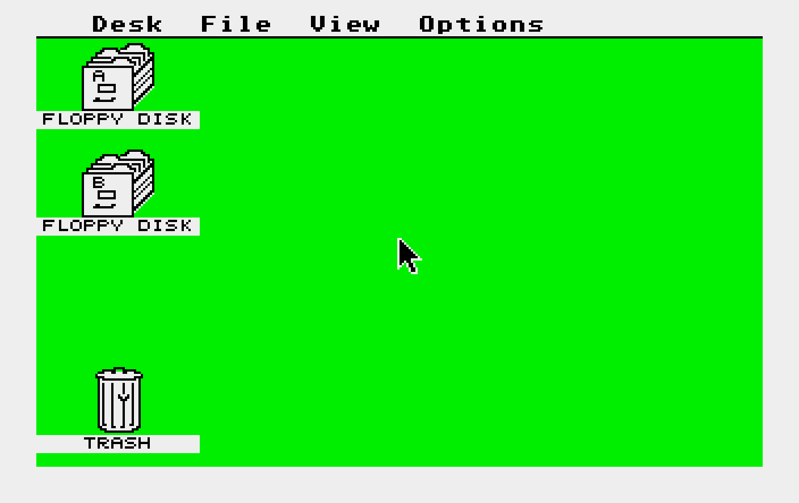
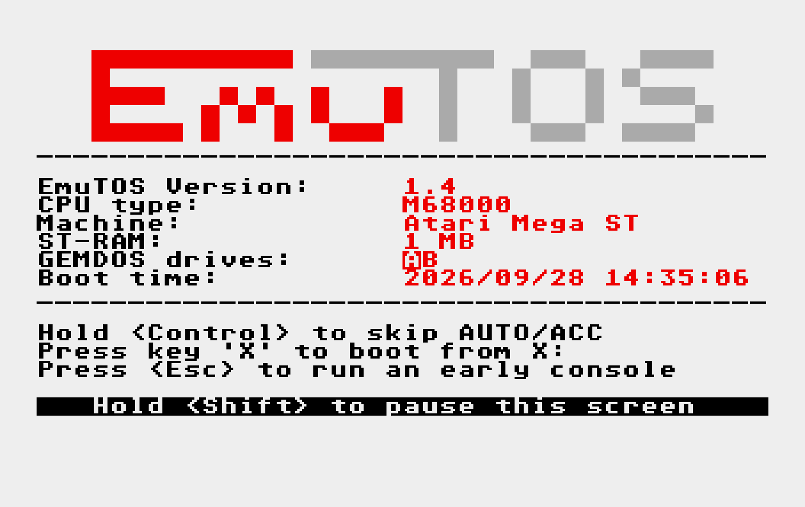

Atari ST/STe and Falcon030 for MEGA65 (MegaST)
==============================================

[](https://buymeacoffee.com/cjf077)
[](https://github.com/sponsors/freemchr)
[](https://sourceping.app/github/freemchr/MegaST)

This is a port of the [AtariST_MiSTer](https://github.com/MiSTer-devel/AtariST_MiSTer)
core (the "MiSTery" Atari ST/STe core by Till Harbaum, Gyorgy Szombathelyi, Jorge Cwik,
Alexey Melnikov and others) to the [MEGA65](https://mega65.org), using the
[MiSTer2MEGA65](https://github.com/sy2002/MiSTer2MEGA65) framework.

Since 1.1.6 MegaST also contains an **Atari Falcon030** (test version, R6 only). The MEGA65 version was engineered for MegaST: the SDRAM memory controller, the 68882 FPU on a
RISC-V CPU inside the FPGA, the MEGA65 integration, the menu, machine switching and TOS handling,
and many fixes. Its CPU and chipset come from the open-source
[Falcon_MiSTer](https://github.com/apolkosnik/Falcon_MiSTer) and
[AP68030](https://github.com/apolkosnik/AP68030) projects.

MEGA65 port by Chris Freeman ([@freemchr](https://github.com/freemchr)).

**Status: the ST/STe is stable and running on real hardware; the Falcon030 is a test version.**
MegaST is developed and tested on a MEGA65 R6 and runs games and GEM programs from floppy and hard
disk images; the Falcon030 boots EmuTOS, TOS 4.04 and FreeMiNT and runs several Falcon demos. Download the core from
[Releases](https://github.com/freemchr/MegaST/releases); see below for what has been tested
on the MEGA65. Please report problems and successes in the
[issues](https://github.com/freemchr/MegaST/issues).

**Latest version: [1.2](https://github.com/freemchr/MegaST/releases/tag/v1.2)**
(October 27, 2026): a new menu look in the style of the Atari GEM desktop, and for the Falcon the
option "Hard disks on SCSI (ICD)", `FASTRAM.PRG` for the Fast RAM under TOS 4.04 and a ready IDE
hard disk image (`extras/` in the zip); see `VERSIONS.md`. 1.1.6 (October 25, 2026) added the
**Atari Falcon030** (test, R6 only), see [New in 1.1.6](#new-in-116-the-atari-falcon030) below.
**Updating from a version older than 1.1.6: copy the new `atarist/fccfg` and `atarist/fcmount`
from the zip**, otherwise the menu settings are not saved. 1.1.5 made the Viking 1280x1024 card work, shown sharp at 1:1 on HDMI.
Since 1.1 (October 16, 2026) **the MEGA65's internal floppy drive** works as the ST's drive A:
(read only, issue #15, see [Real floppy drive](#real-floppy-drive)). Core files for the R3/R3A and
R6 (from 1.1.4 on there are no separate R4 and R5 files; if you have one of these boards, please
open an issue). **All versions up to 0.4.10 damage hard disk images when writing** (issue #11): if
you wrote to an image with one of them, restore it from a backup.

New in 1.1.6: the Atari Falcon030
---------------------------------

> **MegaST is now an Atari ST/STe *and* an Atari Falcon030.** Choose the machine in the menu
> (Help → "Machine" → "Falcon030"). The Falcon is a **test version** and needs the SDRAM of the
> **R6** (the R3/R3A core stays an ST). It runs EmuTOS and Atari's TOS 4.04, Falcon demos and
> programs, and boots FreeMiNT from an IDE hard disk image. Details in
> [Falcon030 (test)](#falcon030-test); please report what works and what does not in the
> [issues](https://github.com/freemchr/MegaST/issues).

**The menu is split per machine.** Every machine has its own settings page, and things that belong
together are grouped:

```
 MegaST
 <floppy, hard disk, TOS and cartridge lines>
 Machine                 >   Atari ST, Atari STe, Mega STe, STEroids, Falcon030
 ST/STe settings         >   memory, blitter, mono monitor, borders, Viking card, stereo YM
 Falcon030 settings      >   monitor (VGA/RGB/TV/mono), CPU 32 MHz, 4 MB ST-RAM, Fast RAM
 Drives & images         >   write protection, floppy swap, real floppy drive, remembering images
 Controllers & ports     >   mice, joysticks, joypads, PMOD ports, Cubase dongles, keyboard
 HDMI / VGA              >   video modes, scanlines, 15 kHz
 CRT emulation, Zoom-in, Audio improvements
 Reset                       resets the machine that runs (was "Reset Atari ST")
```

**How the TOS works with two machines.** The ST and the Falcon need different TOS versions, so
each machine has its own:

| | Atari ST / STe | Falcon030 |
|--|--|--|
| Loaded at power on and after switching to it | `atarist/tos.img` | `atarist/tosfalc.img` |
| In the zip | EmuTOS (256 KB) | EmuTOS for the Falcon (512 KB) |
| TOS it can run | 192 KB (1.00–1.04) or 256 KB (1.06–2.06), EmuTOS | 512 KB (TOS 4.0x), EmuTOS 512 KB |
| A TOS chosen with "TOS:" | remembered for the ST | remembered for the Falcon |

* Choosing a TOS with "TOS:" loads it for the machine that runs and restarts it. With `fcmount`
  on the SD card it is remembered **for that machine** and comes back at the next power on.
* **Switching the machine** (ST ↔ Falcon030) closes the menu, loads the new machine's TOS (the one
  remembered for it, otherwise its `.img` file from the table) and starts it. Switching back gives
  the old machine its own TOS again: for example ST with TOS 2.06 → Falcon with TOS 4.04 → ST
  with TOS 2.06.
* **A TOS the machine cannot run is refused** with a message, and the file browser stays open: a
  512 KB TOS on the ST, or an ST TOS on the Falcon.
* To go back to the `.img` file of the table, choose it with "TOS:" (`tos.img` on the ST,
  `tosfalc.img` on the Falcon). With "Remember TOS/cartridge" off ("Drives & images") the
  machines always start with these files.

**New settings files.** The menu is larger, so 1.1.6 keeps the settings in `atarist/fccfg`
(119 bytes) and the remembered images in `atarist/fcmount` (1792 bytes). **Copy both from the zip**
(and `tosfalc.img` and `fcnvram` for the Falcon). The old `stcfg` and `stmount` are no longer read;
leave them on the card, so going back to 1.1.5 keeps its settings.

**Support:** MegaST is free and open source. If you enjoy it, you can support its development via
[Buy Me a Coffee](https://buymeacoffee.com/cjf077) or [GitHub Sponsors](https://github.com/sponsors/freemchr).

Tested on a MEGA65 R6
---------------------

| Area | Result |
|------|--------|
| TOS 1.04, boot to the desktop | works |
| TOS 2.06 (STe) and EmuTOS 1.4, boot and hard disk | work (tester reports) |
| TOS 1.62 (STe, 1 MB) | works (tester report, issue #21) |
| TOS 1.00, 1.02, 1.06 | boot to the desktop in simulation, not tried on hardware yet |
| Floppy disks: loading, changing disks, reset with a disk inserted, saving | works |
| Hard disk: 4 GB `.vhd` image (MiSTer image), boot, reading files, launching programs | works |
| Hard disk: writing files | broken up to 0.4.10, works since 0.4.11 (tester report, issue #11) |
| Remembered disk images restored at power-on | broken in 0.4.12/0.4.13, works since 0.4.14 (tester reports, issues #11, #12) |
| MEGA65 keyboard, all keys (A fixed in 0.4.7), numeric keypad via MEGA | works |
| Atari ST mouse, in port 1 or port 2 | works; right button as a short click only (see Usage, issue #17) |
| Amiga mouse (optical, incl. right button), in port 1 or port 2 | works |
| mouSTer USB adapter, firmware 3.23.5313, Amiga or 1351 mode (see Usage) | works (tester report, issue #17) |
| Joystick, with debouncing for bouncing and worn switches (Suncom TAC-2) | works |
| Menu settings saved on the SD card (`fccfg`) | works |
| VGA scanlines, full borders | works |
| HDMI picture centred, not cut off on the right (576p, 720x480, 640x480) | works (since 1.0) |
| Internal floppy drive as A: (original Jim Power disk: boot, game) | works (since 1.1); R3-R5 not tested with the drive |
| Internal floppy drive with EmuTOS (drive A: on the desktop) | works since 1.1.1 (no drive icons in 1.1, issue #24); R3-R5 not tested with the drive |
| Games: Golden Axe, Great Giana Sisters, Turrican | work |
| Games: Buggy Boy, Goldrunner, Goldrunner II, The Hitchhiker's Guide to the Galaxy, Lemmings | work (tester report, issue #21) |
| Viking card with `mist_vhi.prg` (TOS 1.04/2.06): sharp 1280x1024 desktop on HDMI, MEGA65 menu, switching off | works (since 1.1.5, R6) |
| Cartridges, PMOD serial/MIDI/printer, Cubase dongles, mono monitor | not tested yet |
| 1351 mouse | works (tester report on the R3, issue #22) |
| HDMI "DVI mode (no sound)" with a DVI monitor | works (tester report, issue #4) |
| R3 and R3A boards (`CORE-R3.xpr`, 512 KB) | work, including hard disk images (tester reports, issues #2, #22) |
| R4/R5 boards (`CORE-R4.xpr`, `CORE-R5.xpr`) | not tested yet |

**Falcon030 (test, R6):**

| Area | Result |
|------|--------|
| EmuTOS for the Falcon (`tosfalc.img`), boot to the desktop | works |
| Atari TOS 4.04, boot to the desktop | works (since 1.1.6) |
| Switching ST ↔ Falcon030 in the menu, each machine with its own TOS | works (since 1.1.6) |
| HDMI picture with "Monitor: VGA (31 kHz)" | works |
| Falcon demos and programs | several work (tested on the R6) |
| FreeMiNT 1.19 from an IDE image (HDDRIVER): kernel, drivers, text shell, TOS desktop (`GEM=ROM`) | works |
| FreeMiNT with the XaAES desktop | white screen, being worked on |
| Fast RAM, 32 MHz turbo, real floppy drive, joypads, serial/MIDI, RGB/TV/mono monitor types | not tested yet |

Screenshots
-----------

| TOS 1.04 desktop | EmuTOS 1.4 (included in the release zip) |
|---|---|
|  |  |

(Frames from the simulation of the core, i.e. the exact picture the core generates, before the
HDMI scaling. Falcon030 screenshots will follow.)

Features
--------

MegaST contains two machines; choose one under "Machine" in the menu.

**Atari ST / STe / Mega STe** (all boards)

* Atari ST, STe, Mega STe (16 MHz) and "STEroids" modes
* 512 KB, 1 MB, 2 MB, 4 MB, 8 MB and 14 MB of ST RAM (R3/R3A: 512 KB)
* Blitter (always on in STe mode, optional in ST mode)
* All TOS versions: 192k TOS (1.00 - 1.04), 256k TOS (1.06, 1.62, 2.06) and EmuTOS;
  `tos.img` is loaded at power on, another TOS image can be loaded from the menu
* Two ACSI hard disks (`.hd`/`.img`/`.vhd` images, read/write, directly on the SD card, up to 4 GB)
* ROM cartridges (raw `.img` or `.stc`, up to 128 kB), Cubase 2 and Cubase 3 dongle
* Viking/SM194 compatible 1280x1024 monochrome card (HDMI: 1:1 at 1280x1024, VGA: 640x512 grey
  scale; not on the R3/R3A)
* Color (low/medium resolution, 50/60 Hz) and monochrome (SM124, 71 Hz or 60 Hz) monitor,
  normal or full borders (overscan)
* YM2149 (mono or stereo) and STe DMA sound
* Real IKBD (HD6301) with the MEGA65 keyboard mapped directly into the ST keyboard matrix
* Mega ST real time clock (RP5C15), set from the MEGA65's real time clock
* STe enhanced joystick ports (fire button only)

**Atari Falcon030** (test version, R6 only, see [Falcon030 (test)](#falcon030-test))

* 68030 with caches and PMMU at 16 MHz, or 32 MHz (turbo); 68882 FPU
* VIDEL graphics: ST modes and Falcon modes with 2 to 256 colours and True Color; monitor type
  VGA, RGB, TV or mono
* DSP56001, DMA sound, sound matrix and YM2149
* 14 MB (or 4 MB) ST-RAM, optionally 48 MB Fast RAM (TT-RAM)
* EmuTOS (`tosfalc.img`, in the release zip) or Atari TOS 4.0x
* Two IDE hard disks (`.hd`/`.img`/`.vhd`, up to 4 GB); FreeMiNT boots
* Enhanced joystick ports (Jaguar style joypads and paddles), NVRAM saved on the SD card

**Both machines**

* Each machine has its own TOS, remembered separately ([TOS](#tos))
* Two floppy drives (`.st` images, read/write), can be swapped (boot from B:); blank disk
  images can be created with `tools/make_st_disk.py`
* The MEGA65's internal 3.5" drive as drive A: (real DD disks, read only)
* The MEGA65 keyboard, with the numeric keypad via the MEGA key and an optional "as printed" layout
* Atari ST mouse, Amiga mouse, Commodore 1351 mouse or mouSTer USB adapter in MEGA65
  joystick port 1 or 2 (menu "Controllers & ports"), joystick in the other port
* Serial port (RS232), MIDI and parallel (printer) port on the MEGA65's PMOD headers (the Falcon:
  serial and MIDI)
* HDMI (720p/576p/480p/600p) and VGA output: 31 kHz (optionally with scanlines) or 15 kHz RGB
  (optionally with composite sync, e.g. for SCART), zoom-in without the border
* Menu settings and mounted images remembered on the SD card

Requirements
------------

* **MEGA65 R3, R3A, R4, R5 or R6** board. On the R4-R6 the ST RAM is in the SDRAM (up to 14 MB).
  The R3/R3A has no SDRAM, and its HyperRAM is too slow for the ST's cycle exact memory timing, so
  its own core (`MegaST-R3-...cor`) keeps the ST RAM in the FPGA's block RAM: **512 KB ST RAM**,
  no Viking card, no STEroids mode and **no Falcon030**; everything else is the same. The
  Falcon030 needs the SDRAM (R6; the R4/R5 have it too but are not tested).
* SD card with a folder `/atarist` containing
  * `tos.img`: the TOS of the ST (mandatory). The release zip contains the free
    [EmuTOS](https://emutos.sourceforge.io) as `tos.img`; a TOS ROM dump of your own Atari also works.
  * `tosfalc.img`: the TOS of the Falcon030 (512 KB; EmuTOS for the Falcon in the release zip, or
    your own TOS 4.0x), and `fcnvram`, the Falcon's NVRAM (in the release zip).
  * your floppy disk images (`.st`), hard disk images (`.hd`, `.img`, `.vhd`) and cartridges (`.stc`, `.img`)
  * `fccfg`, an empty settings file, if you want the menu settings to be saved (in the release
    zip, or `cd M2M/tools && ./make_config.sh fccfg auto`). **Without it, the menu works but its
    settings are not saved.** The file must have exactly as many bytes as the menu has lines
    (`OPTM_SIZE` in `CORE/vhdl/config.vhd`, currently 119). Up to 1.1.5 the file was `stcfg` (104
    bytes); 1.1.6 does not read it, so copy `fccfg` from the zip (the settings start from the
    defaults once).
  * `fcmount`, if the core shall remember the mounted floppy and hard disk images and the TOS and
    cartridge chosen in the menu (in the release zip; up to 1.1.5 `stmount`). It must have exactly
    1792 bytes, all 0x00 or all 0xFF (e.g. `python3 -c "open('fcmount','wb').write(bytes(1792))"`).

Usage
-----

* Press <kbd>Help</kbd> to open the on-screen menu: mount disks, choose the machine, the video
  output and more. Every line and setting is explained in [The menu](#the-menu) below. "Reset"
  resets the machine that runs (like the reset button of the MEGA65, the RAM is kept).
* With `/atarist/fcmount` on the SD card (see Requirements), the core remembers the images you
  mounted and the TOS and cartridge you chose, and loads them again at the next start, before
  the ST boots (so a hard disk is found and the right TOS starts). To unmount (eject) a drive,
  select its line in the menu and press <kbd>Space</kbd>; this also forgets it. A drive that still
  has unsaved writes stays mounted until they are written to the SD card (a few seconds). A long press of the reset button restarts the core like a power cycle, so the
  remembered images come back; unmount them in the menu if you want empty drives. An image that
  is no longer on the SD card is skipped. In "Drives & images", "Remember floppies" and
  "Remember TOS/cartridge" (both on by default) decide whether the floppies and the TOS and
  cartridge come back at the next start; when off, the drives start empty and `tos.img` is used.
  Hard disks are always remembered.
* Keyboard mapping (the MEGA65 has a C64 style layout, symbols are mapped by position):

  | MEGA65               | Atari ST             |
  |----------------------|----------------------|
  | F1, F3, F5, F7, F9   | F1, F3, F5, F7, F9   |
  | Shift + F1 .. F9     | F2, F4, F6, F8, F10  |
  | MEGA + F1 .. F9 (with or without Shift, since 1.0) | Shift + F1 .. F10 (F11 .. F20 in GFA-Basic, STOS) |
  | F11, Run/Stop        | Undo                 |
  | F13                  | Help                 |
  | Inst/Del             | Backspace            |
  | Arrow up (↑)         | Delete               |
  | No Scroll            | Insert               |
  | Clr/Home             | Clr/Home             |
  | Ctrl, Alt, Esc, Tab  | Control, Alternate, Esc, Tab |
  | Caps Lock            | Caps Lock            |
  | `+` `-` `£`          | `-` `=` `\`          |
  | `@` `*` `←`          | `[` `]` `` ` ``      |
  | `:` `;` `=`          | `;` `'` ISO key (`<>`) |

* Numeric keypad: hold the <kbd>MEGA</kbd> key. MEGA + `0`..`9`, `+`, `-`, `*`, `/`, `.` and
  <kbd>Return</kbd> are the keypad keys, MEGA + Shift + `8` / `9` are the keypad keys `(` and `)`.
* **Keyboard "as printed"** (0.4.8, "Controllers & ports" → "Keyboard", issue #6): digits and symbols
  give the character printed on the MEGA65 key instead of the ST key at the same position, e.g.
  Shift + `2` is `"`, `+` is `+`, `@` is `@`, `:` is `:`. The ST's own layout depends on the
  language of the TOS, so choose "As printed, US TOS" or "As printed, UK TOS" (the EmuTOS in the
  release zip is UK). Other TOS languages: use "ST keys (positional)", the default. Characters that
  are not printed on the MEGA65:

  | MEGA65               | Atari ST             |
  |----------------------|----------------------|
  | Shift + `:` / `;`    | `[` / `]`            |
  | Shift + `@` / `*`    | `{` / `}`            |
  | `£`, Shift + `£`     | `\`, `\|`            |
  | Shift + `-`          | `_`                  |
  | `←`, Shift + `←`     | `` ` ``, `~`         |

  Keys without a shifted symbol on the MEGA65 (`0`, `+`, `=`, `↑`) give the same character with Shift.
* **Mouse:** an Atari ST mouse works out of the box. For an **Amiga mouse** (or a mouSTer in
  Amiga mode) or a **Commodore 1351** mouse, select it first in the menu: "Controllers & ports" →
  "Mouse type" → Amiga / 1351. With the wrong mouse type, an Amiga mouse only jitters in small
  steps. "Mouse port" selects the MEGA65 port the mouse is plugged into (default: port 1); the
  joystick goes into the other port. The right button is read from pin 9, which has no pull-up on
  the MEGA65, so an open pin looks like a pressed button. The core therefore ignores the right
  button until it has seen pin 9 released. An adapter that leaves pin 9 open (or a joystick in the
  mouse port) gets no right button, but it no longer holds it down.
* **Right button of an Atari ST mouse:** the Atari mouse does not pull pin 9 up either (on the ST
  the mainboard does). Its button only grounds the pin, and after a release the open line takes
  about 10-13 seconds to float back up (measured on an R6; 2-6 seconds on a tester's board). The
  core can not see the release, so with Mouse type = Atari a right click counts as a **short click
  (200 ms)**: right-click menus work, but holding the right button (dragging, drawing) does not,
  and a second right click only counts once the line has floated back up (about 10 seconds later).
* **mouSTer (USB mouse adapter):** the mouSTer emulates a real mouse so closely that its right
  button has the same pull-up problem: it sticks after the first click. With mouSTer firmware
  **3.23.5313 or newer**, these two setups work (tester report, issue #17):

  | Core "Mouse type" | mouSTer INI                                                  |
  |-------------------|--------------------------------------------------------------|
  | Amiga             | `[mouster] mode=auto` (or `mouse`), `[mouse] type=amiga`, `activepotlines=true` |
  | 1351              | `[mouster] mode=mouse`, `[mouse] type=c1351`, `activepotlines=false` |

  With `activepotlines=true` the mouSTer drives the right button line itself (the same setting
  the MEGA65 Amiga core needs).

The menu
--------

<kbd>Help</kbd> opens and closes the menu. Cursor up/down moves, <kbd>Return</kbd> selects or
toggles, <kbd>Space</kbd> on a drive line ejects the image. A line with `>` opens a submenu;
"Back to main menu" (or <kbd>Help</kbd>) leaves it. Settings marked ✓ are on; they are saved in
`/atarist/fccfg` (see [Requirements](#requirements)).

**Main menu**

| Line | What it does |
|------|--------------|
| TOS: | loads a TOS image for the machine that runs and restarts it (see [TOS](#tos)) |
| Floppy A:, Floppy B: | mounts a `.st` floppy image |
| Hard disk 0:, Hard disk 1: | mounts a hard disk image (ACSI on the ST; on the Falcon IDE master/slave, or SCSI ID 0/1 with "Hard disks on SCSI (ICD)") |
| Cartridge: | loads a cartridge image; <kbd>Space</kbd> removes it |
| Machine: | the machine, see below |
| ST/STe settings, Falcon030 settings, Drives & images, Controllers & ports, HDMI:, VGA: | submenus, see below |
| HDMI: CRT emulation | a CRT-like picture on HDMI (scaler filter); off by default |
| Zoom-in (hide border) | shows only the graphics area without the border; off by default |
| Audio improvements | filters the sound; off by default |
| Reset | resets the machine that runs (warm reset, the RAM and the mounted images are kept) |
| About & Help | version and keys |

**Machine** (one of them)

| Choice | |
|--------|--|
| Atari ST (default), Atari STe, Mega STe (16 MHz), STEroids (turbo) | the ST family; changing between them restarts the ST with a cold boot |
| Falcon030 | the Falcon (test, R6 only). Switching between the ST family and the Falcon closes the menu, loads the TOS of the new machine and starts it |

**ST/STe settings** (only for the ST family)

| Setting | Default | What it does |
|---------|---------|--------------|
| Memory: 512 KB / 1 MB / 2 MB / 4 MB / 8 MB / 14 MB | 1 MB | ST RAM; a change restarts the ST (R3/R3A: always 512 KB) |
| Blitter (Atari ST) | off | the blitter in the Atari ST mode (the STe modes always have it) |
| Mono monitor (SM124) | off | the monochrome monitor (640x400, 71 Hz) instead of colour |
| Mono: 60 Hz, not 71 Hz | off | the mono picture at about 60 Hz, for monitors and HDMI ([Video](#video)) |
| Full borders (overscan) | off | shows the full border area |
| Viking 1280x1024 card | off | the Viking/SM194 card; a change resets the ST ([Viking/SM194 card](#vikingsm194-card)) |
| Stereo YM sound | off | the three YM2149 channels spread over left and right instead of mono |

**Falcon030 settings** (only for the Falcon)

| Setting | Default | What it does |
|---------|---------|--------------|
| Monitor: VGA (31 kHz) / RGB (15 kHz) / TV (15 kHz) / Mono (SM124) | VGA | the monitor the Falcon believes is connected; it decides which video modes TOS and programs offer. The picture goes to HDMI and VGA with every setting, so keep VGA if you use HDMI |
| CPU at 32 MHz (turbo) | off | the 68030 at 32 MHz instead of 16 MHz: about 1.6 times as fast for programs that use the 68030's caches (GEM, most Falcon software); programs that switch the caches off (many older games and demos) run slightly slower than at 16 MHz. Tools that read the Falcon's bus control register still show 16 MHz (a real Falcon only has 8 and 16 MHz) |
| ST-RAM 4 MB (not 14 MB) | off | 4 MB ST-RAM instead of 14 MB |
| Fast RAM 48 MB (TT-RAM) | off | 48 MB Fast RAM at $01000000. EmuTOS uses it by itself; Atari's TOS 4.04 needs `FASTRAM.PRG` in the AUTO folder (`extras/FASTRAM.PRG` in the zip, source in `tools/fastram/`), as a real Falcon needs the driver of its accelerator card |
| Hard disks on SCSI (ICD) | off | the hard disks are SCSI ID 0 and 1 (the Falcon's SCSI port) instead of IDE master and slave. For drivers that do not know IDE, such as ICD: then the same image works on the ST (ACSI) and the Falcon. EmuTOS and HDDRIVER work with both. Takes effect with a reset |

**Drives & images** (both machines)

| Setting | Default | What it does |
|---------|---------|--------------|
| Write protect floppies | off | the floppy images are write protected |
| Swap floppy A: and B: | off | exchanges the drives, e.g. to boot from the disk in B: |
| Real floppy drive as A: | off | drive A: is the MEGA65's internal drive (read only, [Real floppy drive](#real-floppy-drive)) |
| Floppy read assist | ✓ on | cleans up the internal drive's signal and re-reads bad sectors |
| Remember floppies | ✓ on | the floppy images come back at the next start (needs `fcmount`) |
| Remember TOS/cartridge | ✓ on | the chosen TOS (per machine) and cartridge come back at the next start; off: `tos.img` / `tosfalc.img` |

Hard disks are always remembered.

**Controllers & ports**

| Setting | Default | What it does |
|---------|---------|--------------|
| Mouse type: Atari mouse / joystick, Amiga mouse, C64 1351 mouse | Atari | the mouse in the mouse port ([Usage](#usage)) |
| Mouse port: Port 1, joystick port 2 / Port 2, joystick port 1 | port 1 | which MEGA65 port has the mouse |
| STe joypads | off | the MEGA65 joysticks on the enhanced joystick ports (STe, Falcon) |
| PMOD: RS232/MIDI/printer | off | serial, MIDI and printer port on the PMOD headers ([PMOD headers](#pmod-headers-serial-port-midi-printer)) |
| Cubase dongle | off | a Cubase 2/3 dongle in the cartridge port (ST) |
| Keyboard: ST keys (positional) / As printed, US TOS / As printed, UK TOS | positional | the keyboard layout ([Usage](#usage)) |

**HDMI:** 720p 50 Hz (default), 720p 60 Hz, 576p 50 Hz 4:3 or 5:4, 640x480, 720x480, 800x600, and
"DVI mode (no sound)" for DVI monitors. **VGA:** 31 kHz (default), 15 kHz (RGB, SCART), 15 kHz with
CSync, and scanlines 25/50/75 %. See [Video](#video).

Using disk images
-----------------

### The menu and the file browser

* <kbd>Help</kbd> opens and closes the menu. Cursor up/down moves, <kbd>Return</kbd> selects.
* Selecting "Floppy A:", "Floppy B:", "Hard disk 0:", "Hard disk 1:", "TOS:" or "Cartridge:"
  opens the file browser in `/atarist`. Cursor up/down selects a file, cursor left/right turns the
  page, <kbd>Return</kbd> opens a folder or mounts the file, <kbd>Run/Stop</kbd> cancels.
  <kbd>F1</kbd> / <kbd>F3</kbd> switch between the internal and the external SD card.
* The browser only shows the file types the core can use: `.st` (floppy), `.hd`, `.img`, `.vhd`
  (hard disk), `.img`, `.rom` (TOS), `.stc`, `.img` (cartridge).
* The menu shows the name of the mounted image next to the drive. To **unmount (eject)** a drive,
  select its line and press <kbd>Space</kbd>. The same on the "Cartridge:" line **removes the
  cartridge**: the ST restarts without it.
* With `/atarist/fcmount` on the SD card (in the release zip), the mounted images and the chosen
  TOS and cartridge are **remembered** and loaded again at the next start ("Remember floppies" and
  "Remember TOS/cartridge" in "Drives & images" switch this off for the floppies or the TOS).

### Floppy disk images

1. Copy the `.st` image into `/atarist` on the SD card (or into a subfolder).
2. Press <kbd>Help</kbd>, select "Floppy A:" and choose the image.
3. To boot from it (most games): select "Reset" in the menu, or switch the MEGA65 off
   and on with `fcmount` on the SD card. A disk mounted while the ST is running is seen like a
   real disk change, e.g. to open it on the desktop.
4. **Disk changes:** when a game asks for disk 2, mount disk 2 on "Floppy A:" (no reset).
5. **Saving:** the ST writes into a copy in memory; about 2 seconds after the last write the core
   writes the image back to the SD card. The **drive LED is yellow** until that is done: don't switch
   off or remove the SD card while it is yellow. "Write protect floppies" (Drives & images)
   protects the images; "Swap floppy A: and B:" boots from the disk in B:.
6. New empty disk (e.g. for game saves): `python3 tools/make_st_disk.py blank.st` on your computer
   (see [Floppy disks](#floppy-disks)).

### Hard disk images

1. Copy the image (`.hd`, `.img` or `.vhd`, up to 4 GB) into `/atarist` on the SD card.
2. Press <kbd>Help</kbd>, select "Hard disk 0:" and choose the image. Large images show
   "Scanning disk image..." for a moment.
3. **Reset the ST** ("Reset" in the menu). TOS only looks for hard disks when it starts,
   so a hard disk mounted while the desktop is shown does not appear without a reset. With
   `fcmount` the image is mounted at power on before the ST starts, so no reset is needed.
4. With **EmuTOS**, drive C: appears on the desktop by itself. With **Atari TOS**, the hard disk
   driver on the image (HDDRIVER, AHDI, ICD, ...) starts first and adds drive C:. If there is no C:
   icon, add it once with "Options" → "Install Disk Drive" (TOS 1.x) or "Install Icon" (TOS 2.06),
   then "Save Desktop".
5. Hard disk writes go straight to the SD card (no delay). The drive LED is red while the ST
   accesses the hard disk.

More about images, drivers and Hatari images: [Hard disks](#hard-disks).

### FAQ

**My image is not in the file browser.** Only `.st`, `.hd`, `.img`, `.vhd`, `.rom` and `.stc`
files are shown. `.msa` and `.stx` floppy images and `.zip` files are not supported: unzip them
on your computer and convert `.msa` to `.st` (e.g. with Hatari's `hmsa` tool:
`hmsa game.msa` writes `game.st`). `.stx` (Pasti, copy protected originals) cannot be converted.

**The hard disk is mounted, but there is no drive C:.** Reset the ST after mounting (see above).
With Atari TOS the image needs a bootable hard disk driver, and a C: icon on the desktop. A quick
test: boot the EmuTOS from the release zip. If EmuTOS shows C:, the image works and the problem is
the driver or the desktop setup. (0.4.12 and 0.4.13 ejected a hard disk image restored at power-on
again inside the core, so TOS did not see it; fixed in 0.4.14, issues #11 and #12.)

**The game does not start from the floppy.** Mount the disk on "Floppy A:" and reset the ST. Some
games need a real Atari TOS (TOS 1.02 or 1.04 for the ST, see [TOS](#tos)), some need 512 KB or
1 MB of memory or the ST (not STe) machine type. A few images in circulation are defective, see
[Game notes](#game-notes).

**Are my saves on the floppy kept?** Yes, if the image is not write protected: wait until the
drive LED is no longer yellow before switching off.

**How do I get empty drives at the next start?** Unmount the drives with <kbd>Space</kbd> in the
menu. Without `/atarist/fcmount` on the SD card, all drives start empty anyway.

**Some games of a hard disk game collection don't start.** Most hard disk versions of games need
1 MB of ST RAM or more (512 KB is often not enough, e.g. on the R3/R3A), and some only work with
certain TOS versions. If a game fails, try more RAM and another TOS, and compare with Hatari using
the same image and TOS.

**Can I use a folder of my PC as drive C: like in Hatari?** No, that is an emulator feature
("GEMDOS drive"). The core needs a hard disk image, like a real ST.

TOS
---

Each machine has its own TOS: `/atarist/tos.img` for the ST family and `/atarist/tosfalc.img` for
the Falcon030 are loaded at power on and when you switch to that machine. "TOS:" in the menu loads
another TOS image (`.img` or `.rom`) for the machine that runs and restarts it (cold boot). With
`/atarist/fcmount` on the SD card (in the release zip), this choice is remembered **for that
machine** and loaded again at the next start and after switching back to it. Without `fcmount`,
`tos.img` / `tosfalc.img` are used again after a power cycle. How this works with the two machines,
in a table: [New in 1.1.6](#new-in-116-the-atari-falcon030).

| Machine | TOS |
|---------|-----|
| Atari ST | 192k TOS 1.00 - 1.04, 256k TOS 1.06 - 2.06, EmuTOS |
| Atari STe, Mega STe, STEroids | TOS 1.06 or newer (1.62, 2.06), EmuTOS |
| Falcon030 | 512k TOS 4.0x (4.04 tested), EmuTOS for the Falcon (512 KB) |

A TOS of the wrong size for the machine is refused with a message.

**Mega STe speed:** like a real Mega STE, the Mega STe mode starts at 8 MHz with the cache off; TOS
2.06 does not switch it. Set 16 MHz and the cache in the XControl "General" panel (or with a speed
utility). "STEroids" always runs at full speed and has no speed setting; tools that only know
the real Atari models cannot measure it.

**Which TOS?** EmuTOS is in the release zip only because it is free and may be distributed (Atari's
TOS may not). It is fine for GEM programs and for a first test, but some games crash with it.
**For games, use a real Atari TOS:** TOS 1.02 or 1.04 for the ST (some games only run reliably
with TOS 1.02), TOS 1.62 or 2.06 for the STe. Use a ROM image dumped from your own Atari.

**TOS 1.06 and 1.62 start slowly:** after a cold boot without a hard disk, the screen stays
white for about 14 seconds (measured in the simulator) before the desktop appears. The TOS boot
code waits for a hard disk on the ACSI bus; the ST has not hung.

**Changing the memory size or the machine type:** since 0.4.8 the ST restarts with a cold boot by
itself (issue #7). In 0.4.7 and older it did not boot after such a change, because TOS keeps the
old memory layout in RAM and trusts it at the next reset: load a TOS with "TOS" in the menu (or
switch the MEGA65 off and on) after the change.

Real time clock
---------------

The ST has the clock chip of the Mega ST (Ricoh RP5C15 at $FFFC21), which TOS 1.02 and newer and
EmuTOS use automatically. It shows the time of the MEGA65's real time clock: set the clock in the
MEGA65 configuration utility. Setting the time on the ST (e.g. in the control panel) does not
change the MEGA65 clock and is overwritten by it.

Hard disks
----------

On the ST the hard disks are ACSI targets 0 and 1; on the Falcon030 they are the IDE master and
slave (the Falcon has no ACSI port; HDDRIVER and EmuTOS work with IDE images, see
[Falcon030 (test)](#falcon030-test)). With "Falcon030 settings" → "Hard disks on SCSI (ICD)" they
are SCSI ID 0 and 1 instead, for drivers without IDE support such as ICD (whose boot code on
the IDE disk finds nothing and shows no message). The images are raw disk images (as used by Hatari,
MiSTer and MiST; `.hd`, `.img` or `.vhd` like on MiSTer, but not a Microsoft "dynamic" VHD),
e.g. with a DOS (MBR) or Atari (AHDI) partition table. Images can be almost 4 GB large (the
limit of FAT32); disks larger than 1 GB need a driver with ICD commands (EmuTOS, HDDRIVER). EmuTOS finds the
partitions automatically; with Atari TOS you need a hard disk driver (AHDI, HDDRIVER, ...),
e.g. on a boot floppy or on the hard disk itself.

**A ready image for the Falcon:** `extras/falcon128.img` in the zip is a blank 128 MB IDE image
with four FAT16 partitions of 32 MB (C: to F:, "TOS & Windows compatible", no byte swapping).
Copy it into `/atarist`, choose it as "Hard disk 0:" and reset: EmuTOS shows C: to F: by
itself. To copy files onto it from a PC: on Linux `sudo mount -o loop,offset=32768
falcon128.img /mnt` (C:); on Windows a tool such as OSFMount. `tools/make_falcon_hd.py` makes
other sizes (`python3 make_falcon_hd.py --size 64 my.img`).

How to use a hard disk image: see [Hard disk images](#hard-disk-images) above.

Images that work in Hatari do not always work here:

* Hatari often uses a PC folder as drive C: ("GEMDOS drive"). That needs no driver and no image at
  all, so it works with any TOS. A real ST, and MegaST, needs a hard disk image with a driver.
* Hatari also emulates IDE and SCSI disks. The ST and STe only have ACSI; the image must be prepared
  for an ACSI disk (HDDRIVER and AHDI images usually are).
* An image without a bootable driver (e.g. created by Hatari's `atari-hd-image` tool, which writes
  a DOS partition table and no driver) works with EmuTOS, but with Atari TOS only together with a
  driver from a boot floppy.

A first test: if EmuTOS shows drive C: for the image, the image and the ACSI disk work, and any
problem with Atari TOS is in the driver setup.

The images are **not** loaded into RAM: every sector is read from and written to the SD card
directly (write-through). The FAT32 library of the framework can only seek from the start of a
file, following the cluster chain; the firmware therefore remembers the cluster of every 2 MB of
an image (4 MB for images larger than 1 GB, 8 MB above 2 GB) and seeks from there or from the
current position (see `M2M/rom/vd_fastseek.asm`), so random access is fast in large images, too.

Floppy disks
------------

The floppy disk images (`.st`, 360 kB to 1.44 MB) are loaded into the HyperRAM and written back
to the SD card when the ST writes to them. "Swap floppy A: and B:" in "Drives & images"
exchanges the drives, e.g. to boot from the disk in B:.

To create an empty, formatted disk (e.g. a save disk for a game), run
`python3 tools/make_st_disk.py blank.st` on your computer (options: `--size 360|720|800|1440`,
`--label NAME`) and copy the image into `/atarist` on the SD card. (The FDC emulation cannot
format a disk, so formatting a disk image in TOS does not work.)

Real floppy drive
-----------------

Since 1.1 the ST can use the MEGA65's internal 3.5" drive as drive A:. Switch on "Real floppy
drive as A:" in "Drives & images" and choose "Reset". Drive A: is then the disk in the
MEGA65's drive; drive B: and the floppy images are not used until you switch it off again. With
EmuTOS this needs 1.1.1 or newer (1.1 showed no drive icons, issue #24).
Up to 1.1.1 a reset took 5 to 10 seconds longer while the real drive was on (TOS waited for the
missing drive B:); fixed in 1.1.2. With no disk in the drive, TOS still waits a moment for drive A:.
Original ST disks are read as on a real ST: the core has a complete WD1772 floppy controller
(WF1772IP by Wolfgang Förster), so copy protections and formats with 10 or 11 sectors and more
than 80 tracks work.

* **Read only:** the core never writes to the disk. Programs that save to the disk (high scores,
  save games) get an error.
* **DD disks only** (the 720 KB type). HD disks are not supported.
* **"Floppy read assist"** (Drives & images, on by default): the MEGA65 drive's speed varies
  within each turn of the disk, more than an Atari drive's, and the WD1772 then misreads a sector
  now and then. Some loaders hang on such an error. With read assist the core cleans up the
  timing of the drive's signal and re-reads a sector that failed its checksum (up to 15 more
  turns) before the ST gets it. Switch it off only to compare.
* **Weak disks:** a disk that reads fine in a PC drive can still have weak spots. If a disk does
  not load, try it in a real ST or make a fresh copy (e.g. with a Greaseweazle) and report it in
  issue #15, with the board, the disk and the program.

Game notes
----------

Tester reports about single games and disk images. Please report others in the
[issues](https://github.com/freemchr/MegaST/issues), with the name and MD5 of the image.

| Game / image | Note |
|--------------|------|
| Road Blasters (1988)(U.S. Gold).st (TOSEC, MD5 `f3afdf00840c7e91b48d6b3daf8a4daf`) | **Defective image**, also misbehaves in Hatari: no joystick control, and after a reset a long write back to the SD card (issues #8, #9). Use a different dump. |
| Gauntlet | Works; press Insert (MEGA65 No Scroll) to start the game (issue #9). |

Video
-----

* **Falcon030:** the VIDEL picture goes to HDMI and VGA like the ST's; its resolutions and colour
  depths are chosen in TOS or by programs, and the menu's "Monitor" setting only decides which
  modes are offered (see [Falcon030 settings](#the-menu)).
* **HDMI:** the image is scaled by `ascal` (4:3, with the border). "Zoom-in (hide border)" shows
  only the graphics area (320x200, 640x200 or 640x400) and uses the full width of 16:9 modes.
  The border is black on VGA in this mode.
* **DVI monitors** (HDMI-to-DVI cable or adapter): if the picture is garbled, enable "DVI mode
  (no sound)" in the HDMI settings. It switches off the HDMI audio and info packets that DVI
  monitors cannot decode. If the menu is unreadable on the DVI monitor, change the setting while
  a VGA monitor is connected (the setting is saved), or try a lower HDMI mode such as 800x600.
* **VGA:** the color modes are 15 kHz modes. By default they are doubled to 31 kHz for VGA
  monitors ("VGA: 31 kHz"), optionally with scanlines (25%, 50%, 75%). "15 kHz (RGB, SCART)"
  outputs the original 15 kHz signal for CRTs and TVs, "15 kHz with CSync" puts composite sync on
  the HSync pin (for MiSTer style VGA-to-SCART cables). The monochrome mode is output unchanged
  with the original SM124 timing (640x400, 71.2 Hz, 35.7 kHz), so the VGA monitor must accept
  that mode. "Mono 60 Hz" adds blank lines to get ~60 Hz (same 35.7 kHz line rate).
* **HDMI and the 71 Hz mono mode:** the HDMI output always runs at the HDMI mode's rate
  (50 or 60 Hz). `ascal` writes the 71 Hz frames into its frame buffer and reads them at the
  output rate, so some frames are dropped (about 1 in 6 at 60 Hz). Since 1.1.3 the frame buffer has
  16 bits per pixel and three buffers: no flicker at 720p and no tear line. For smooth motion,
  enable "Mono 60 Hz" and use a 60 Hz HDMI mode.

Viking/SM194 card
-----------------

Enable "Viking 1280x1024 card" in "ST/STe settings" and load a Viking driver. The card uses
$C00000, so the ST RAM must be 8 MB or less (with more, the menu item has no effect); in the
STEroids mode the card is at $E80000 and all 14 MB can be used. The MiST driver works: put
`mist_vhi.prg` from
[mist-board/tools/mist_vhi](https://github.com/mist-devel/mist-board/tree/master/tools/mist_vhi)
into the AUTO folder, or boot from
[mist_vhi.st](https://github.com/mist-devel/mist-board/blob/master/tools/mist_vhi.st). It finds
the card at either address. As soon as the driver accesses the card, the video output switches to
the card. Switching the menu item on or off resets the ST (with the card off, the driver reports
"No video memory found" and the ST starts as usual).

On **HDMI**, the picture is shown 1:1 at 1280x1024: while the Viking desktop is on screen, the
HDMI output switches to 1280x1024 @ 60 Hz (108 MHz pixel clock, the VESA mode of 5:4 PC
monitors) and back to the HDMI mode of the menu when the card is switched off. This mode is not
a TV mode: PC monitors show it, many TVs do not. On **VGA**, 2x2 pixels are averaged into one of
five grey levels: 640x512 @ 60 Hz, 31 kHz.

Falcon030 (test)
----------------

**The Falcon030 is a test version.** It boots EmuTOS and Atari's TOS 4.04, runs many Falcon programs and
demos and starts FreeMiNT from a hard disk image, but it has seen much less testing than the ST. Please report what works and what does not in the
[issues](https://github.com/freemchr/MegaST/issues).

The MEGA65 version was engineered for MegaST: the SDRAM memory controller, the 68882 FPU on a
RISC-V CPU inside the FPGA, the MEGA65 integration, the menu, machine switching and TOS handling,
and many fixes. Its CPU and chipset come from the open-source
[Falcon_MiSTer](https://github.com/apolkosnik/Falcon_MiSTer) and
[AP68030](https://github.com/apolkosnik/AP68030) projects.

R6 only (it needs the SDRAM; not on the R3/R3A). Choose **Machine: Falcon030** in the menu. Switching
between the ST and the Falcon closes the menu, loads the TOS of the new machine and starts it.

**TOS**: the Falcon needs a Falcon TOS, the ST an ST TOS, and each machine has its own. At power on
and after switching the machine in the menu, the core loads `atarist/tos.img` for the ST and
`atarist/tosfalc.img` for the Falcon (EmuTOS for the Falcon, 512 KB, in the zip). A TOS loaded with
the menu item "TOS:" replaces it for the machine that runs, and with `fcmount` on the SD card it is
remembered for that machine: switching from the ST with TOS 2.06 to the Falcon and back gives the
ST TOS 2.06 again. A TOS the machine cannot run is refused when you choose it (the ST cannot use a
512 KB TOS, the Falcon needs one). Without `tosfalc.img` the Falcon gets `tos.img` and does not
start (the menu still works). Atari's TOS 4.04 works: copy your own TOS 4.04 image (512 KB) to the
SD card and choose it with "TOS:" while the Falcon runs.

**FreeMiNT**: a FreeMiNT 1.19 installation on an IDE hard disk image (with HDDRIVER) boots: the
kernel, its drivers, the network setup and the text shell work, and with `GEM=ROM` in `mint.cnf`
TOS 4.04's own desktop runs under FreeMiNT. The XaAES desktop does not start yet: the screen turns
white right after XaAES has loaded its kernel module (also without NVDI and without the video mode
change); the MEGA65 menu still works. This is being worked on; until then use `GEM=ROM`. Reports
with other FreeMiNT setups are welcome.

**What it has**

* 68030 with its caches and PMMU, 16 MHz like a real Falcon or 32 MHz ("CPU at 32 MHz (turbo)"; the
  turbo helps programs that keep the caches on, see the menu reference)
* 68882 FPU (it runs on a small RISC-V CPU in the FPGA, so FPU-heavy programs are slower than on a
  real Falcon)
* VIDEL graphics: the ST modes and the Falcon modes with 2 to 256 colours and True Color; monitor
  type VGA, RGB, TV or mono (SM124). **The "Monitor" setting is the monitor the Falcon believes is
  connected, not the MEGA65 output you use:** it decides which video modes TOS and programs offer.
  The picture goes to HDMI and to the VGA connector with every setting, so "VGA (31 kHz)", the
  default, also works with an HDMI TV or monitor only (tested on an R6 over HDMI).
* DSP56001, DMA sound, the sound matrix and the YM2149
* 14 MB ST-RAM (or 4 MB) and optionally 48 MB of Fast RAM (TT-RAM) at $01000000
* Two floppy drives (`.st` images) and the MEGA65's internal drive as A:
* Two IDE hard disks: "Hard disk 0:" is the IDE master, "Hard disk 1:" the slave (up to 4 GB), or
  SCSI ID 0 and 1 with "Hard disks on SCSI (ICD)"
* Enhanced joystick ports (Jaguar style joypads and paddles via "STe joypads")
* Serial port and MIDI on the PMOD headers
* The NVRAM (boot video mode, language, boot drive) is saved on the SD card as `/atarist/fcnvram`

The settings are in the menu under "Falcon030 settings". Because the Falcon's menu is larger, the core keeps its
settings and remembered images in `/atarist/fccfg` and `/atarist/fcmount`. **Copy both from the
zip**: without `fccfg` the settings are not saved. The files `stcfg` and `stmount` of older versions
stay untouched.

**Not working or not tested yet**

* Programs for a 68060 accelerator (CT60/CT63): the Falcon has a 68030
* FreeMiNT's XaAES desktop: white screen, see above (FreeMiNT with `GEM=ROM` works)
* Hard disk drivers other than EmuTOS's own and HDDRIVER (for example AHDI, and ICD on SCSI): not tested yet
* Microphone input: the MEGA65 has no audio input

PMOD headers (serial port, MIDI, printer)
-----------------------------------------

When "PMOD: RS232/MIDI/printer" is enabled in the "Controllers & ports" menu, the PMOD headers
are powered and used as follows (3.3V TTL levels, all inputs have pull-ups):

| Pin         | Signal                       | Pin         | Signal                     |
|-------------|------------------------------|-------------|----------------------------|
| PMOD1 lo[0] | RS232 CTS (in)               | PMOD1 hi[0] | MIDI OUT (out)             |
| PMOD1 lo[1] | RS232 TXD (out)              | PMOD1 hi[1] | MIDI IN (in)               |
| PMOD1 lo[2] | RS232 RXD (in)               | PMOD1 hi[2] | printer STROBE (out)       |
| PMOD1 lo[3] | RS232 RTS (out)              | PMOD1 hi[3] | printer BUSY (in)          |
| PMOD2 lo[0..3] | printer D0..D3 (in/out)   | PMOD2 hi[0..3] | printer D4..D7 (in/out) |

PMOD1 lo matches the Digilent PMOD UART pinout (e.g. a PmodUSBUART or a MAX3232 module).
MIDI needs the usual opto-coupler (IN) and driver (OUT) circuit. The parallel port pins also
allow "Gauntlet" style joystick adapters.

**MT32-pi:** the MT32-pi reads serial MIDI with 3.3V levels on the GPIO UART of the Raspberry Pi
(`midi_in = gpio` or the default configuration of the MT32-pi with a GPIO MIDI connection), so it
can be connected without any MIDI circuit: PMOD1 hi[0] (MIDI OUT) to the RXD pin of the Pi (GPIO
15) and GND to GND. Its sound comes from the audio output of the Pi. (On MiSTer the MT32-pi audio
is mixed into the core via I2S; this is not supported.)

Not supported (yet)
-------------------

* Ethernec, MT32-pi audio mixing (MIDI to an MT32-pi works, see above)
* Jaguar pad buttons beyond fire on the STe joystick ports (the MEGA65 joysticks have one button)

Building and development
------------------------

How the port works, the source files, the changes to the MiSTer core, the tests and how to build
the core: see [doc/DEVELOPMENT.md](doc/DEVELOPMENT.md).

License
-------

GPL v3, see [LICENSE](LICENSE). The MiSTer core is licensed under GPL v2 or later (FX68K:
GPL v3). TOS is copyrighted by Atari and is not part of this repository.
